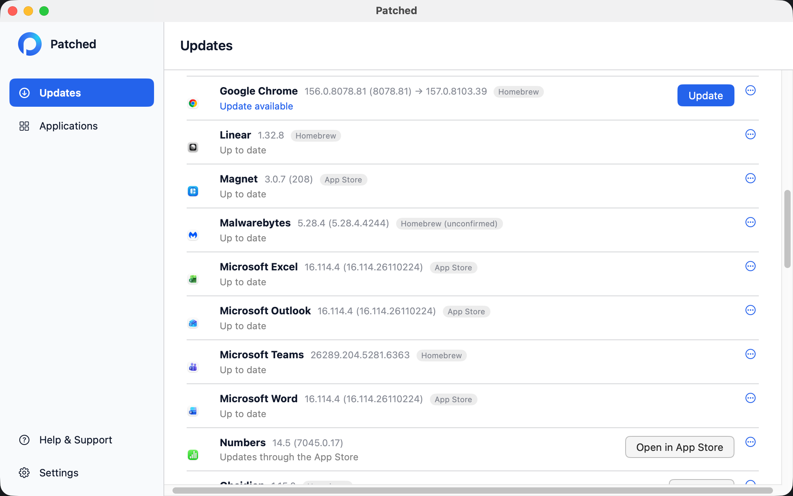
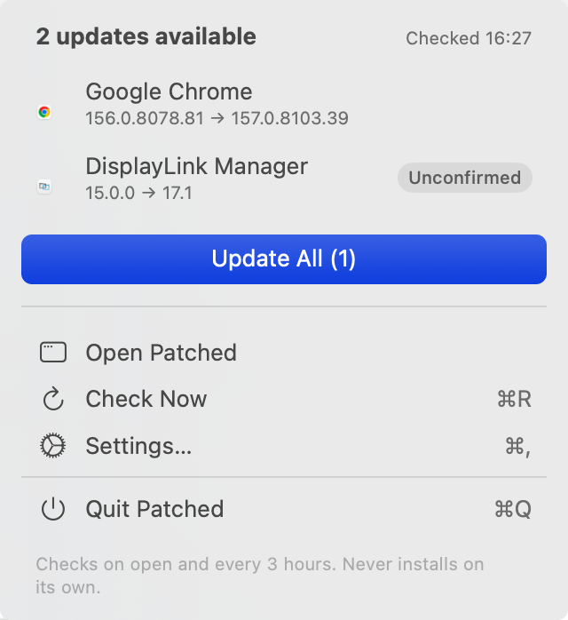
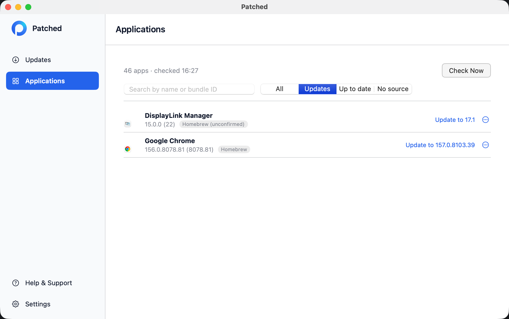

# Patched

Patched is a free, open-source Mac app updater. It is a community project with no
company or support behind it. The source is licensed under the
Apache License 2.0. Copyright © 2026 Andy Bridson. See [LICENSE](LICENSE) and [NOTICE](NOTICE), including the
Installomator attribution.

Patched checks installed apps for updates, obtains update information from
configured sources, verifies downloaded apps, and is designed to replace an app
with a recoverable transaction. Its Swift package requires Swift 6 and macOS 13
or later.

<!-- Raw HTML so the 2x screenshots display at their natural size; these paths are
     relative to the repository root, where the export promotes this file. -->
<p></p>
<p>


</p>

## Requirements

Patched needs a Mac with Apple silicon running macOS 13 or later. Intel Macs are
not supported. Building from source needs Swift 6.

## Download

Releases are on [GitHub Releases](https://github.com/birdseeed/patched/releases).
Releases are currently ad-hoc signed and not notarised, because my Apple Developer
Program enrolment is pending; see [Install a release](#install-a-release) for how
to open one safely.

## Build from source

On macOS with Swift 6 installed, build with:

```sh
swift build
/bin/bash scripts/build-app.sh
open dist/Patched.app
swift run patched check
```

The app bundle includes the `patched` CLI. The final command runs a read-only
check directly from the source tree. See [packaging/README.md](packaging/README.md)
for local packaging options.

For contributors, `./scripts/verify.sh` runs the complete local build and checks.
The gate requires Node 22 or later for an independent source guard. Private
reference catalogue checks run only when their reference tree is present; the
public source tree contains everything needed for its own gate.

## Using the app

The Updates screen provides **Update**, **Update All**, **Roll back** and
**Recover**. Patched checks when it opens and every three hours while it runs
(a recent check within ten minutes suppresses the opening check). Scheduled
checks only report available updates and notify you; they do not install them.
Use **Open at login** in Settings to have the installed app start when you log in.
Settings also shows whether notifications are on, with a button to open macOS
Notification Settings.

Mac App Store apps are reported but never installed by Patched: it asks Apple's public App Store lookup for the latest version (only the bundle IDs of your App Store apps are sent, and only to Apple; ignore an app in the catalogue to stop that) and tells you to update it in the App Store.

Patched also tells you when a newer Patched release exists. On the same schedule (when it opens, every three hours and on Check Now) it makes a single anonymous request to GitHub for the latest release of this repository (`api.github.com/repos/birdseeed/patched/releases/latest`). The request carries no identifying data beyond a plain `Patched/<version>` User-Agent. If the release is newer than the app you are running, the menu and the Updates screen show "Patched 0.2.0 is available" with a **Download** button, and you get one notification per new version. Download opens that release's page on GitHub in your browser, only when you click it.

Patched can also update itself, but only when you ask. Next to **Download** there is an **Update** button (and an **Update…** button on the notification). It asks "Update Patched to 0.2.0? Patched will quit and reopen." and does nothing until you confirm. Then it downloads that release's ZIP from GitHub, checks it against an Ed25519 signature made with my release key (the public half is built into Patched), checks the new app's bundle ID, version and code signature, swaps it in for the running Patched, keeps the previous version as a backup, and reopens. If any check fails, the installed Patched is left as it was. If replacing Patched would need administrator rights, it opens the release page instead. Scheduled checks, Update All and the command line never install Patched.

If you have Patched 0.1.2 or earlier, install 0.1.3 by hand once (see [Install a release](#install-a-release)); from then on Patched offers in-app updates.

Patched keeps its update state and backups in
`~/Library/Application Support/Patched/Updater`, and its cache in
`~/Library/Caches/Patched/Updater`. First use migrates legacy `mac-updater`
state without overwriting an existing destination. An unfinished transaction
must be recovered before migration can finish. See
[THREAT-MODEL.md](THREAT-MODEL.md) for migration and recovery details.

## Install a release

Releases are ad-hoc-signed ZIP files for Apple silicon. They are not signed with
a Developer ID or notarised yet, because my Apple Developer Program enrolment is
pending. Download the ZIP from [GitHub Releases](https://github.com/birdseeed/patched/releases),
check its SHA-256 against the one in the release notes (`shasum -a 256 Patched-0.1.0.zip`),
extract it, then move the included Patched app to your Applications folder.
macOS Gatekeeper may block an app from such a ZIP. First check that you trust the
source and release. If macOS blocks it, use System Settings → Privacy & Security
→ Open Anyway for that specific app. Do not disable Gatekeeper or lower system
security globally.

Each release also has a `Patched-<version>.zip.sig` file: the Ed25519 signature
Patched checks before it updates itself. Without a Developer ID there is no Team ID
to pin, so that signature, made with my release key, is what Patched trusts for its
own updates. Releases are source and ZIP downloads; there is no Homebrew tap at
this stage.

## Command-line interface

The command is `patched`. The supported command shapes are:

```text
patched check [--json] [--app <path>] [--explain <app path | bundle ID>]
patched update <app path | bundle ID> [--quit] [--dry-run] [--json]
patched update --all [--quit] [--dry-run] [--json]
patched rollback <app path | bundle ID> [--quit]
patched recover [--quit]
patched backups
```

`check` is read-only. `--dry-run` downloads and verifies an update in a staging
folder, then cleans it up without installing. `--quit` asks a running app to
quit; it is not force-killed. The updater refuses to replace apps that require
administrator privileges; use the app's own updater for those. A `.pkg` update
is verified (hash, the installed app's Developer ID Installer Team ID and
notarisation) and then opened in Apple's Installer, where you finish it with
your own password. Roll back isn't supported after a `.pkg` update, because a
package can install more than the app. Set `PATCHED_ENABLE_PKG_UPDATES=0` to
turn `.pkg` updates off.

## What update verification checks

For an update, Patched uses the installed app's signed Team ID as its identity
pin. It requires HTTPS, including redirects, streams downloads into a private
folder, applies a size limit, and checks available feed length and SHA-256 or
SHA-512 hashes. When an installed app supplies a Sparkle EdDSA public key, the
download must also have a valid EdDSA signature.

The candidate app must have the same bundle ID, contain no symlinks escaping the
app, pass strict code-signature checks, use the pinned Team ID, pass Apple's
notarisation assessment, and have the offered version newer than the installed
version. After replacement, Patched checks the installed app again. It keeps a
backup, supports rollback, and records a journal for crash recovery. Rollback
applies the same signature, Team ID, and notarisation checks before restoring a
backup. Checks fail closed when a safe state cannot be established.

These checks do not protect against malware already running as your user, or a
developer's compromised signing key or update server. A valid update signed by
the expected Team ID can still be malicious.

## Support

This is a community project without company-backed support. If you find a
problem, see [CONTRIBUTING.md](CONTRIBUTING.md) and [SECURITY.md](SECURITY.md).
If Patched saves you time, you can [buy me a coffee](https://buymeacoffee.com/andybridson).
Donations go towards an Apple Developer ID, so releases can be signed and notarised.
